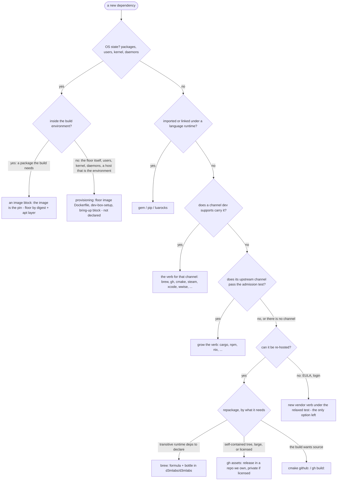
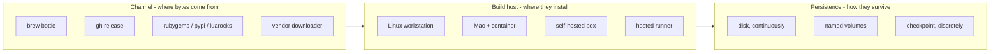

# Dependency channels: which verb, when to repackage, what the tap admits

The consumer-facing rule for declaring a dependency in `dependencies.rb`: which DSL verb carries it, when a package goes into a channel d3mlabs owns instead of its upstream one, and how the result stays warm on every host dev runs on. The reasoning and the rejected alternatives are [ADR-0010](DECISIONS.md#adr-0010--the-verb-follows-the-channel) and [ADR-0011](DECISIONS.md#adr-0011--groups-are-purpose-only-integrations-carry-their-own-manifest-one-lockfile); the design they came from is [plans#50](https://github.com/d3mlabs/plans/issues/50). How the pieces fit inside dev is [deps-architecture.md](deps-architecture.md).

## Vocabulary

- **Channel** — where a dependency's bytes come from: a brew bottle, a GitHub release asset, rubygems, a vendor downloader. Each channel is one DSL verb and one integration.
- **Shape** — what the dependency becomes on disk. An *immutable version-keyed tree* is published once at `<base>/<version>/`, siblings coexist, presence is proof (gh trees, steam depots, the wwise cache; brew kegs are this shape under brew's ownership). A *mutable workdir* is converged in place by a tool toward the lock, one state per directory (a gem home, a venv, a Wine prefix). A *tool cache* is a location dev names and the tool owns. *OS state* is below the floor: provisioning, not a dependency.
- **Scope** — who needs it and where: `group`, `host`, `env`, `platform`.
- **Activation** — putting a dependency on the project's PATH or environment through the project shadowenv. Any shape can be activated; `dev deps path` answers the absolute path for scripts. Activation is a capability every integration has, never a reason to prefer one channel over another.
- **Keg / linking / keg-only / bottle** — brew's words: a keg is one installed version, `Cellar/<formula>/<version>/`; linking symlinks one keg onto PATH; keg-only formulae are never linked; a bottle is a prebuilt binary of a formula.

## Which verb

The first yes decides:

**OS state inside the build environment is an `image` block; the rest is provisioning.** A package the build needs on the OS — `winbind`, `dos2unix`, a `libxyz-dev` — goes in the project's `image` block in `dependencies.rb` (dev#277): a floor (`from:` a base image we publish, resolved to its digest), a `platform`, and `apt` lines. dev generates the Dockerfile and **the image is the pin**: the lock records the floor digest, the platform, the apt set and the content digest that is also the registry tag, so a package added is a reviewed lock diff and a new image, never a hand edit to a Dockerfile. `apt` exists only inside that block — there is no `apt` verb, and a tool brew carries is still `brew`. The image carries nothing from the lock; the container's own `dev deps install` installs that inside. Everything else — the floor image itself (its publisher's Dockerfile), users, kernel modules, daemons, and a host that *is* the environment's platform — is still installed by whoever sets the host up: `dev-box-setup`, a workstation's bring-up block. That gap stays, accepted; see ADR-0010 and its 2026-10-25 note.

**A language runtime's own packages take its verb.** A Ruby library is `gem`, a Python one `pip`, a Lua one `luarocks`, whatever else might carry it.

**A supported channel's verb wins over a new one.** The supported channels: `brew`/`cask` (tap-pinned, keg-verified), `gem`, `pip`, `luarocks`, `gh` releases, `cmake` (git and url), `steam`, `ficsit`, and the two vendor channels `xcode` and `wwise`. If the thing you need is in one of them, that verb is the answer, including when a release in our own tap or repo also carries it.

**Growing a verb needs a channel that passes the admission test** — what every `Repository` already has to provide, stated as criteria:

1. an enumerable or addressable universe of versions;
2. immutable published versions — an exact version re-installs the same bytes months later;
3. integrity dev verifies, or the tool enforces from facts in the lock;
4. an install dev can probe per host without root.

Channels that pass and would be added if a project needs them: cargo, npm, nix, conda/pixi. Each costs about what ficsit, luarocks and steam each cost for one project — five classes — once, and nothing per package afterwards. Channels that fail, and why: `apt`/dnf (per-suite versions, archives drop old builds, root, system scope — [dev#284](https://github.com/d3mlabs/dev/issues/284)); snap, winget, floating docker tags (no immutability); docker images as a dependency carrier (an OS, not files — ADR-0007, ADR-0008). `xcode` and `wwise` are admitted under a *relaxed* test — addressable, not enumerable — because their artifacts cannot be re-hosted, so no stricter channel could ever exist for them.

**Sugar verbs are not channels.** `ruby` and `python` express cross-integration coupling (bundler's `ruby` directive, pip's venv) plus activation; underneath they mint a declaration in a real channel.

## When to repackage

An own formula in the tap or an own release in a repo we control is legitimate on exactly three paths, and the formula's or release's description names which one:

1. **No channel exists.** The engine; MSVC under Wine; Ruby (ruby-build is lockable but compiles two to three minutes per host, and the prebuilt rubies that exist are not relocatable).
2. **A channel exists but fails admission.** Wine via apt.
3. **We change the bytes.** Patches, relocation — a reason to own the release even when a supported channel carries the upstream.

Which channel to repackage into follows what the package needs: a **brew formula and bottle** when it has transitive runtime dependencies to declare (`depends_on` installs the closure a bare tree cannot — Ruby's openssl, libyaml, zlib); a **`gh` release** when it is a self-contained tree, large, or licensed (private repo); **source** (`cmake github:` or `gh build:`) when the build wants it.

A *thin lift* — a formula that re-hosts an artifact a supported channel already carries, without changing the bytes — is a stopgap and names its retirement condition. Three exist in the tap today (`clang-format@18.1.8`, `powershell@7.4.0`, `axslcc`); none is wrong where it sits, and [homebrew-d3mlabs#6](https://github.com/d3mlabs/homebrew-d3mlabs/issues/6) retires them now that `gh` trees activate on PATH.

The economics behind the rule: a channel costs dev once and nothing per package; a repackage costs a formula or release per upstream version, per platform, for as long as we consume it.

## Brew, specifically

Brew is the cross-platform binary channel for anything with transitive runtime dependencies: one formula syntax with prebuilt bottles on a Mac and on Linux, tap pinning (ADR-0003), bottle sets (ADR-0004), carry-over (ADR-0005), and the bottle cache in the store. Two things to know as a consumer:

- Two projects or branches may lock two versions of one formula. Brew links one keg onto PATH; dev activates the *locked* keg in the project shadowenv (`.shadowenv.d/515_brew.lisp`, `Cellar/<formula>/<keg>/bin` for every locked formula that has a `bin`), so each project runs its own regardless of which keg brew linked. A `gh` tree with a `bin/` is activated the same way (`515_gh.lisp`).
- `brew upgrade` and `brew cleanup` delete kegs a lock still names. After every install dev adds the locked formulae to `HOMEBREW_NO_CLEANUP_FORMULAE` in your `~/.homebrew/brew.env` (or `$XDG_CONFIG_HOME/homebrew/brew.env`), so your own `brew cleanup` leaves their kegs; the list only grows, since releasing a name needs to know no other project on the machine locks it. dev does not `brew pin`: a pin would refuse the upgrades convergence relies on, and brew warns dependents of a pinned formula may break.
- A keg at another version than the lock is converged, not reported (ADR-0003 note, dev#350): dev pours the exact bottle the lock names for this machine — fetched from the lock's link, verified against the lock's digest, cached in the store — up or down, and falls back to `brew update` + `brew upgrade <formula>` for a version with no bottle to pour here. A mismatch that survives that is a lock behind brew's formula: `dev deps update`.

Kegs live in the brew prefix, outside the data root, so persistence on a host covers two directories: free on a disk or a checkpoint, a second named volume (`dev-linuxbrew`) on a Mac's container.

## Groups, integration tooling, the lockfile

Groups select by consumer role — `dev deps install --group`, `--except` — like bundler groups and npm dev dependencies. Nothing else: `:build` is not special. Where a dependency runs is `host:`.

An integration carries its own `dependencies.rb` in the same DSL a project uses. When a project's manifest uses the integration, dev resolves that manifest into the **project's lock** — ordinary pins in their channel, with provenance (`needed_by: xcode`) — in the scope of the declaration that used it. So a project that pins an Xcode gets `xcodes` in its lock without declaring it; a project that does not, does not. `xcode` and `wwise` ship this way ([dev#290](https://github.com/d3mlabs/dev/issues/290)): their manifests export `brew "xcodes", host: :darwin` and `brew "wwise-cli", tap: "d3mlabs/d3mlabs"`, and the installer orders each needed pin's batch before its user's — see [deps-architecture.md](deps-architecture.md#integration-manifests).

A library's manifest follows the Gemfile/gemspec convention, for every verb: **ungrouped declarations export** to the consumer; **grouped declarations are private**; a library declares **ranges** and the project **locks**; `ruby`, `python` and `env` never propagate. A `gh` dependency's own `dependencies.rb` at the locked tag is read the same way ([dev#291](https://github.com/d3mlabs/dev/issues/291)): the engine exports the toolchain it was built with, and the project declares the engine alone.

One lockfile, `deps.lock`, every group in it ([dev#293](https://github.com/d3mlabs/dev/issues/293)). `build-deps.lock` is retired with the image-membership role it existed for.

## How warmth survives

Three axes that are easy to discuss as one:

The verb is a channel choice. Warmth is shape × the host's persistence mechanism, and has nothing to do with which group a dependency is in or whether it is "build" or "runtime". A workstation and a box persist the data root and brew prefix continuously on a disk; a Mac's container persists them on two named volumes; a hosted runner persists them discretely in the **checkpoint** — a GitHub custom image of the whole boot disk, minted by a `main`-only job after a green run that changed a lock file. A cache action for a workdir ([dev#265](https://github.com/d3mlabs/dev/issues/265)) is an optimization of the gap between the checkpoint and the current lock, built only if the measured gap warrants it. See [Setting up a host](../README.md#setting-up-a-host-warmth-is-the-data-root).
